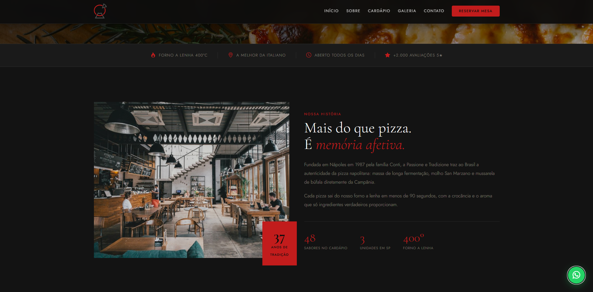

<p align="center">
  
</p>

<p align="center">
Uma experiência digital inspirada na tradição das autênticas pizzarias italianas.
</p>

<p align="center">
  
  
  
  
</p>

---

## Sobre o Projeto

**Pizzeria Passione** é uma landing page desenvolvida para representar a elegância, tradição e autenticidade da cultura gastronômica italiana.

O projeto foi inspirado em uma pizzaria real localizada na Itália, buscando transmitir através do design a atmosfera acolhedora, sofisticada e artesanal encontrada nos tradicionais restaurantes italianos.

Toda a identidade visual foi cuidadosamente planejada para valorizar elementos como:

- Paleta escura e elegante
- Destaques em vermelho inspirados na culinária italiana
- Tipografia refinada
- Layout responsivo
- Experiência visual focada em storytelling

---

## Design & Conceito

O desenvolvimento visual do projeto contou com o uso do **Adobe Illustrator**, utilizado para criação e refinamento dos elementos gráficos da interface, garantindo uma identidade visual consistente e alinhada com a proposta premium da marca.

A proposta foi unir:

- Tradição italiana
- Design moderno
- Experiência imersiva
- Performance e responsividade

---

## Tecnologias Utilizadas

### Front-end

- HTML5
- CSS3
- JavaScript

### Design

- Adobe Illustrator

---

## Funcionalidades

- Navegação suave entre seções
- Layout responsivo
- Galeria de imagens
- Apresentação institucional da pizzaria
- Cardápio destacado
- Botão flutuante de contato via WhatsApp
- Interface otimizada para desktop e mobile

---

## Estrutura do Projeto

```bash
📦 Pizzeria-Passione
 ┣ 📂 img
 ┣ 📜 index.html
 ┣ 📜 style.css
 ┣ 📜 script.js
 ┗ 📜 README.md
```

---

## Objetivo Acadêmico

Projeto desenvolvido como parte das atividades práticas da **EBAC (Escola Britânica de Artes Criativas e Tecnologia)**, com foco na aplicação de conceitos de desenvolvimento front-end, design de interfaces e responsividade.

---

## Autor

**Eryck Ferreira**

Desenvolvedor Front-end em formação e apaixonado por criar experiências digitais visualmente marcantes.

---

<p align="center">
  Feito com dedicação, café e muita inspiração italiana.
</p>
